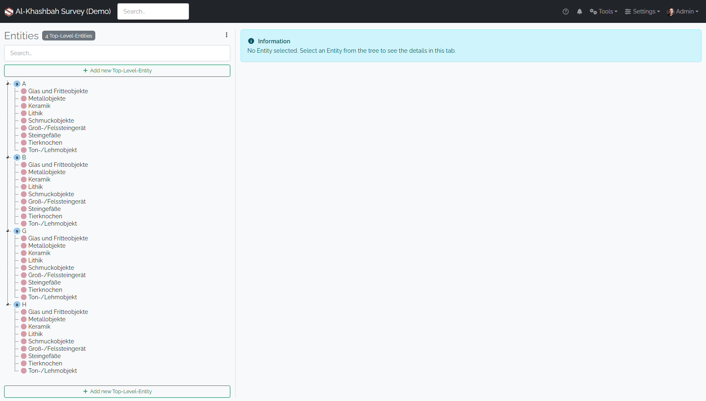
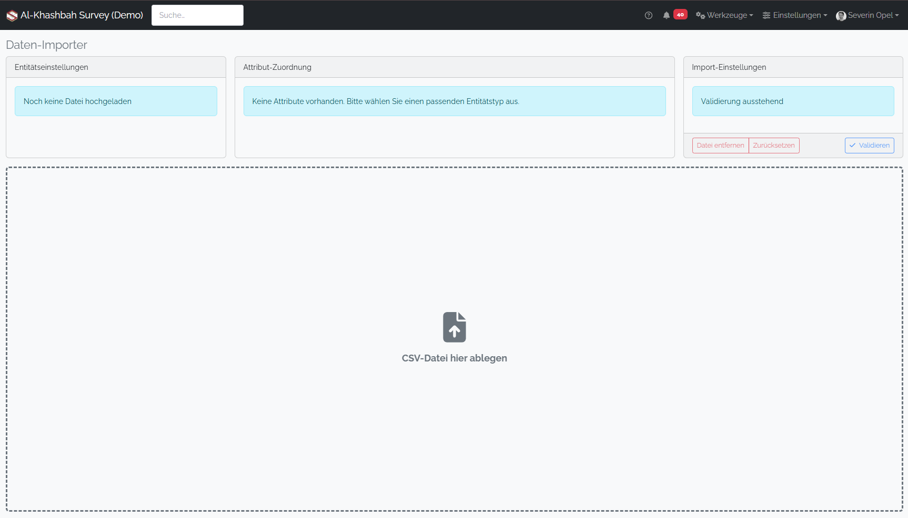
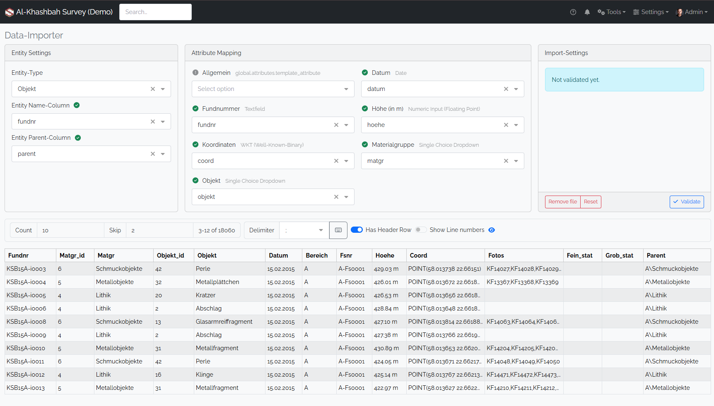
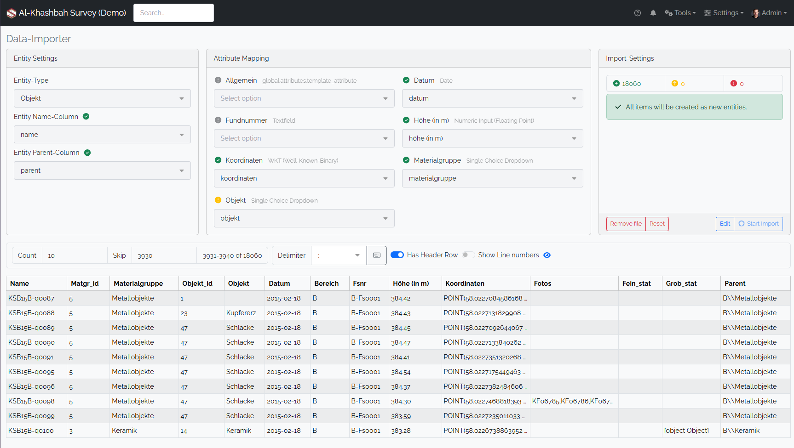

# Data Importer

The data importer is used to import already existing data to the spacialist software using CSV files.   

The upload process is strict on purpose to avoid adding unintended values. As the importer is a utility to the software and not standard way of handling data. This chapter will explain the steps required in greater detail. It is straightforward, when following the aforementioned conventioned, but can be confusing and somewhat tedious for the initial setup.

[[toc]]

## Prerequisites

### CSV with UTF-8 encoding
Your CSV table needs to be in UTF-8 format (see FAQ).

### Parent-Column if necessary
When you want to place the elements into a specific location in the [Entity Tree](./entity.md#entity-tree), then you need to specify a parent path column, that defines the absolute path to the created (or updated) entity. This path is composed from the entity names, separated by double backslashed (`\\`).

### Follow Attribute Type Import Standards

When using more complex attribute types. You must adhere to a specific formatting convention. You can checkout these conventions at [Attribute Types](./attribute-types.md). 

## Getting Started

In this example we have A, B, G and H as top-level entities and they each contain a set of categories.
Now we want to add our `Object` entities at the correct location. So we go to the Data Importer at `Tools/Data Importer`.

## Upload CSV File

When you land on the site, it is quite empty. You need to upload your csv file to the application, by either clicking on the upload area or just dragging it into the area.

## Validate CSV File

Your CSV file will be rendered at the bottom and show you a preview of your data. Make sure it is rendered correctly. You may have to adjust the column delimiter otherwise all text is rendered in a single column.

- Select the appropriate delimiter in the toolbar (the preview table should update immediately)
- Verify that all data is present and that there are no additional (empty) rows at the end of the file (If you know your data it would be enough to check the lines count)
 
## Entity Settings

After the file was dropped, the `Entity Settings` becomes available and the application automatically tries to guess the appropriate mapping. The table must be rendered correctly, so that you can associate the columns with the settings accordingly. You need to specify the following settings:

| Name | Description | Format | Auto-Mapping Keys| Required |
|---|---|---|---|---|
Entity Type | An import always targets one specific entity type as you must match the columns to the respective attributes of said Entity-Type (see Attribute Mapping). | _is selected_ | - | * |
Entity Name-Column | An entity must have a name. If the selected row has an empty value inside that column, the importer will not validate and the indiicator next to the label will be rendered in red. When hovering it'll tell you how many rows are invalid. | string | name, key| * |
Entity Parent Column | If the entities you are about to import are **NOT** top level entities, you must specify where they should be located inside the application. | string separated by '\\\\' | parent, path | - |

### Preview Settings

These settings are available only in certain preview builds and may change in the future:

| Name | Description | Format | Auto-Mapping Keys| Required |
|---|---|---|---|---|
Reference (Literature) | Adds quotes to the reference tab. | citekey:description;citekey_2:description_2;...| reference, source | -
Licence | Adds a license text to the metadata tab | string | licence | -
Description (Contributors) | Adds text to the description field of the metadata tab | string | attribution, contributors, description | -

## Attribute Mapping

Once it is selected, the `Attribute Mapping` becomes available and the app tries to automatically map all column to their respective attributes by the proximity to the attribute label. **You are not required to upload all columns, empty columns in the mapping will be just ignored.** Ensure the Mapping is correct, the green checkmark symbolizes that all rows contain some value (but it does not check if the entry is valid), if some values are missing it displays a yellow exclamation point and on hover it tells you how many rows are missing.
  

## Validation

If the mapping's are done correctly, you can proceed to the validation step. In the `Import Settings` window press the validate button. Now the csv file will be actually uploaded to the server and will check if all fields meet the attribute's requirements, e.g. are all entries formatted correctly, are all thesaurus concepts available, etc. If not, every error will be listed in the `Import Settings` panel. Also a widget is shown, that will indicate how many records will be created, how many will be updated or how many errors occured.

If errors occur, you must edit your csv file locally until it doesn't contain any errors. 
Click "Remove File" to reset all settings and upload the fixed file.
 When the file is error-free, the widget tells you how many create and how many update operations will be made. This is a valuable information as it prevents you from creating or updating unintended entities.

## Import

When you are sure that you want to do the import, then click the `Start Import` button. As the validation and creation does contain expensive database operations, it may take some time until the validation and the actual upload is completed. If the file is too large, the application will report a timeout. As a workaround, you can upload the CSV file in smaller batches. 

## Final Checkup

After uploading first **reload the page to reliably fetch all uploaded entities**. 
Now you should ensure inside the Entity Tree that your data was imported successfully.

## FAQ

### How to export an CSV file from Excel?

Excel provides an overcomplicated way to reach the CSV export function:
File > Export > Select "Change File Type" from list > Select "CSV ... (*.csv)" (subheading: "Other Filetypes") > Click "Save As" > A file Dialog opens, **But don't click "SAVE" yet and read the next question before continuing!** 

### How to export an UTF-8 CSV file from Excel?

Excel exporter uses different localized encodings to export the data.
But we need the data in the global standard format (UTF-8).

Follow the steps of _"How to export an CSV file from Excel?"_
and then you need to select the dropdown with the label "File Type"
and search for (and it's not even close to the selected entry) "CSV UTF-8 ... (*.csv)"

Now you finally press "Save" and you have a properly encoded CSV file.

